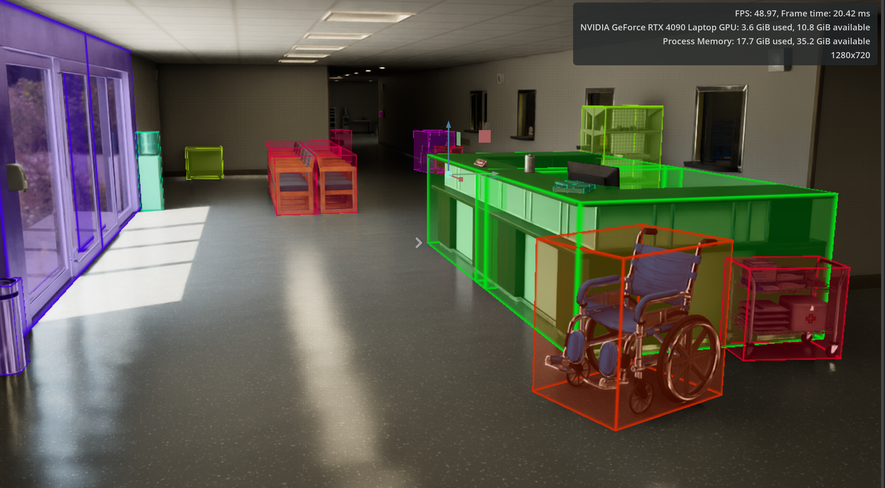
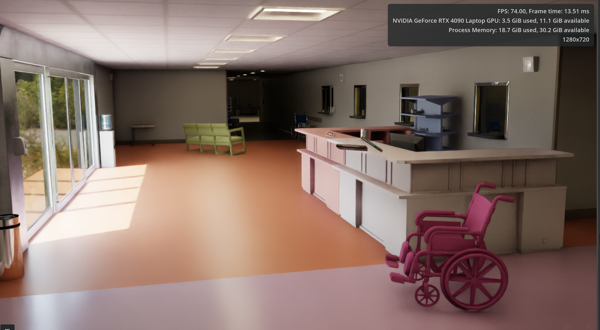
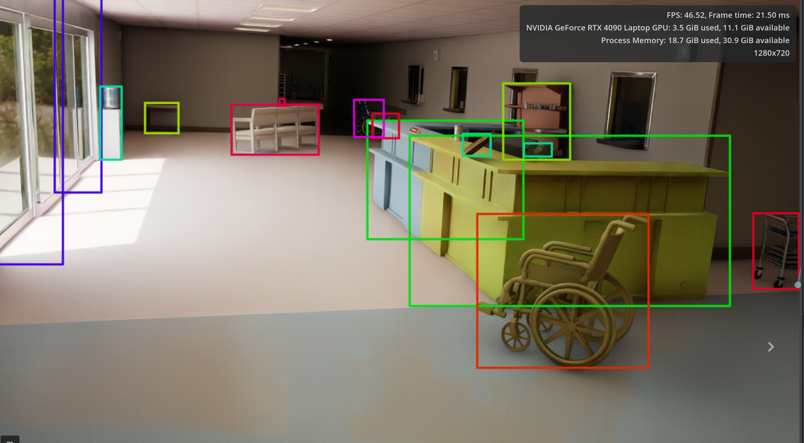
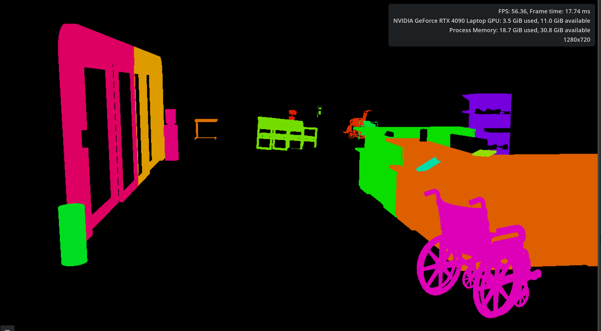

# Synthetic Data Healthcare

This repository contains a hospital USD scene and an Omniverse-compatible Python randomization script for generating diverse healthcare environment variations.

The current setup is aimed at **scene randomization** rather than full dataset export. It changes object poses, materials, lighting, and camera position over time so the same hospital scene can be reused to produce many visually different synthetic-data samples.

## Repository Layout

- `assets/hospital_env_labelled.usd` — the hospital scene used as the base environment.
- `scripts/replicator_sdg.py` — the randomization script designed to run inside an Omniverse / Isaac Sim Python environment.

## What the Script Does

When `scripts/replicator_sdg.py` is run with the hospital USD stage open, it:

- randomizes the position of selected hospital props while trying to keep them separated,
- applies fresh rotations per object category,
- assigns randomized preview-surface materials to configured objects and surfaces,
- perturbs existing light intensity and color,
- slightly perturbs the camera pose,
- repeats the process continuously across multiple variations.

The script keeps a cached copy of the original transforms so that each variation is generated from the baseline scene instead of accumulating offsets over time.

## Current Configuration

The main tunable parameters live near the top of `scripts/replicator_sdg.py:12`.

- `NUM_VARIATIONS = 30` — number of variation IDs before looping.
- `VARIATION_INTERVAL = 2.0` — seconds between updates.
- `RANDOM_SEED = 42` — deterministic seed for repeatable randomization.
- `CAMERA_PATH = "/World/hospital/Camera"` — camera prim to perturb.
- `RUN_WHILE_PAUSED = True` — applies variations even if the timeline is not playing.

Object and surface targets are configured in:

- `OBJECT_PATHS` at `scripts/replicator_sdg.py:42`
- `SURFACE_PATHS` at `scripts/replicator_sdg.py:80`

## Requirements

This project is intended to run inside an NVIDIA Omniverse-based app such as Isaac Sim or another Kit app that provides:

- `omni` Python modules,
- `omni.timeline`,
- `omni.usd`,
- Pixar USD Python bindings via `pxr`.

It is **not** expected to run in a plain system Python interpreter.

## How to Use

### Option 1: Run from the Script Editor

1. Open Isaac Sim or a compatible Omniverse app.
2. Load `assets/hospital_env_labelled.usd`.
3. Open the built-in Script Editor.
4. Paste the contents of `scripts/replicator_sdg.py` or run that file from the editor.
5. Watch the scene update every `VARIATION_INTERVAL` seconds.

### Option 2: Use as a Scene Randomization Building Block

Use this script as the randomization layer in a larger synthetic-data pipeline, for example by pairing it with:

- Replicator writers,
- viewport capture,
- semantic or bounding-box annotators,
- scheduled capture logic after each variation is applied.

## Behavior Summary

### Object placement

The script classifies objects such as chairs, wheelchairs, carts, books, and medical items, then applies category-specific spacing and rotation constraints.

### Materials

It generates a palette of preview-surface materials under `/World/RandomizedMaterials` and rebinds them across configured meshes.

### Lighting

It does not create new lights. Instead, it scans the stage for supported existing lights and perturbs their intensity and color.

### Camera

If `/World/hospital/Camera` exists and is a USD camera, the script adds small translation and rotation changes per variation.

## Important Notes

- The stage must already be open before the script runs.
- The configured USD prim paths must match the contents of the loaded scene.
- Scene edits happen live in memory inside the Omniverse app.
- The script starts an async loop and restarts it cleanly if rerun in the same session.
- This repository currently contains randomization logic, not a full end-to-end dataset export pipeline.

## Suggested Next Steps

If you want to turn this into a more complete synthetic-data project, the next logical additions are:

- image/RGB capture after each variation,
- annotation export,
- train/validation split generation,
- configuration via JSON or YAML instead of hardcoded paths,
- object target discovery from labels or metadata instead of fixed prim paths.

## Quick Start Summary

Open `assets/hospital_env_labelled.usd`, run `scripts/replicator_sdg.py`, and use the resulting scene variations as input to your own synthetic-data capture workflow.# synthetic_data_healthcare
